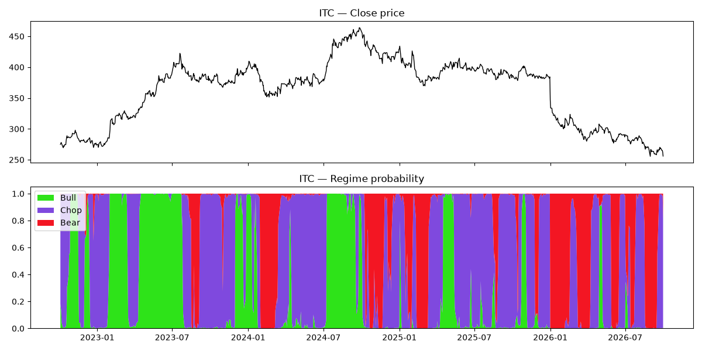

# Market Regime Engine (HMM)

A hidden Markov model that labels each trading day of an NSE stock as **Bull**, **Bear** or **Chop** (sideways), using only information available up to that day.

Tested on ITC, Maruti Suzuki and TCS, with daily data from Oct 2022 to Sep 2026.

## How it works

**1. Features** (`Data_extractor/extract.py`): three numbers per day, all built from past prices only:

| Feature | What it measures | How |
|---|---|---|
| `obs_mom` | Trend direction and strength | 40-day average log return ÷ its volatility × √40 (a trend t-stat) [3] |
| `obs_vol` | Is volatility unusually high or low? | 20-day ATR as % of price, logged, z-scored over 1 year [4] |
| `obs_er` | Is price going somewhere or going in circles? | Kaufman efficiency ratio: net 20-day move ÷ sum of daily moves (0 = chop, 1 = clean trend) [5] |

**2. Regime model** (`Modelling/Model_form.py`)
- Three hidden states. Each state expects different feature values: Bull = positive trend, calmer vol, efficient moves; Bear = negative trend, higher vol, efficient moves; Chop = no trend, normal vol, inefficient moves.
- A transition matrix makes regimes persistent: each state has a 92–95% chance of continuing the next day.
- A forward filter [1][2] updates the regime probabilities one day at a time. It never looks at future data, so every label could have been known on that day.

**3. Data-fitted comparison** (`Modelling/fit_hmm.py`)
- Estimates the same kind of model's parameters from data with Baum-Welch [6] (`hmmlearn`), using 2022–2024 only.
- Tests it on 2025–26, a period it never saw.

**4. Evaluation** (`Modelling/backtest.py`)
- Measures what each stock did after each regime label.
- Runs a simple rule against buy-and-hold: hold the stock only during Bull, sit in cash otherwise, act the day after the signal, and pay 0.1% per trade.

## Results

| Stock | Buy & hold (per yr) | Bull-only (per yr) | Buy & hold max drawdown | Bull-only max drawdown | Time in market |git
|---|---|---|---|---|---|
| ITC | −1.8% | **+6.1%** | −44.9% | **−15.1%** | 25% |
| Maruti | **+7.9%** | +2.0% | −33.5% | **−15.6%** | 35% |
| TCS | −6.9% | **−2.6%** | −53.4% | **−22.0%** | 29% |

**What this shows**
- **The engine is a risk filter, not a return predictor.** On every stock it cut the worst peak-to-trough loss by more than half, mainly by staying out during long declines (ITC and TCS in 2025–26).
- **It doesn't reliably forecast returns.** The returns that followed each regime were inconsistent across stocks. On Maruti, the stock did best *after* Chop, and the Bull-only rule gave up most of its uptrend.
- **Regimes are persistent but not sluggish.** They last about 16–20 trading days on average, and the model switched to Bear the same week as the Jan 2026 ITC gap-down.

## Out-of-sample check: letting the data choose

The parameters above were set by hand while looking at the charts, so their results are in-sample. To get an honest test, `fit_hmm.py` fits the parameters on 2022–2024 and evaluates them on 2025–26 only.

**What the data chose.** Left to itself, the model separates regimes mainly by **volatility**, not by trend versus chop:

| Fitted state | Momentum | Volatility | Efficiency ratio | Avg length |
|---|---|---|---|---|
| Down | −0.59 | +0.41 | 0.22 | ~27 days |
| Calm uptrend | +0.73 | −1.16 | 0.24 | ~39 days |
| Volatile uptrend | +0.97 | +0.98 | 0.25 | ~34 days |

The efficiency ratio is almost identical across the three states. The Bull/Bear/Chop scheme is therefore a definition imposed on the data rather than a structure the data finds by itself. Because of this, the fitted model's trading rule is "hold the stock unless the state is Down".

**Results on 2025–26 (annual return / max drawdown)**

| Stock | Buy & hold | Fitted model (out-of-sample) | Hand-tuned model (in-sample) |
|---|---|---|---|
| ITC | −30% / −41% | −20% / −30% | −6% / −10% |
| Maruti | +4% / −34% | +8% / −18% | +9% / −9% |
| TCS | −35% / −51% | −13% / −21% | 0% / −5% |

- **The drawdown reduction survives out of sample.** On data it never saw, the fitted model beat buy-and-hold on all three stocks and cut the worst loss by roughly a third to a half.
- **The hand-tuned model's 2025–26 numbers are not a fair comparison.** It was tuned while looking at these charts, so the gap between the two models is mostly look-ahead, not skill.

## Limitations
- **Hand-tuned parameters:** the main model's parameters were set by eye on the same period they are evaluated on, so its results are in-sample and likely optimistic. `fit_hmm.py` provides the out-of-sample check.
- **Small universe:** only three stocks over four years.
- **Short blips:** some regime changes last only a few days; acting on them would add trades.
- **Feature overlap:** momentum and the efficiency ratio both measure trend, and the model treats them as independent, which makes it somewhat overconfident.

## Possible extensions
- Walk-forward testing: refit the parameters every year and test on the following year.
- Extend to the Nifty 50 and sector indices.
- Scale position size by regime probability instead of a simple in/out switch.

## References
1. Hamilton, J. (1989). A New Approach to the Economic Analysis of Nonstationary Time Series and the Business Cycle. *Econometrica*, 57(2).
2. Rabiner, L. (1989). A Tutorial on Hidden Markov Models and Selected Applications in Speech Recognition. *Proceedings of the IEEE*, 77(2).
3. Moskowitz, T., Ooi, Y. & Pedersen, L. (2012). Time Series Momentum. *Journal of Financial Economics*, 104(2).
4. Wilder, J. W. (1978). *New Concepts in Technical Trading Systems*.
5. Kaufman, P. (1995). *Smarter Trading*.
6. Baum, L. E., Petrie, T., Soules, G. & Weiss, N. (1970). A Maximization Technique Occurring in the Statistical Analysis of Probabilistic Functions of Markov Chains. *Annals of Mathematical Statistics*, 41(1).
